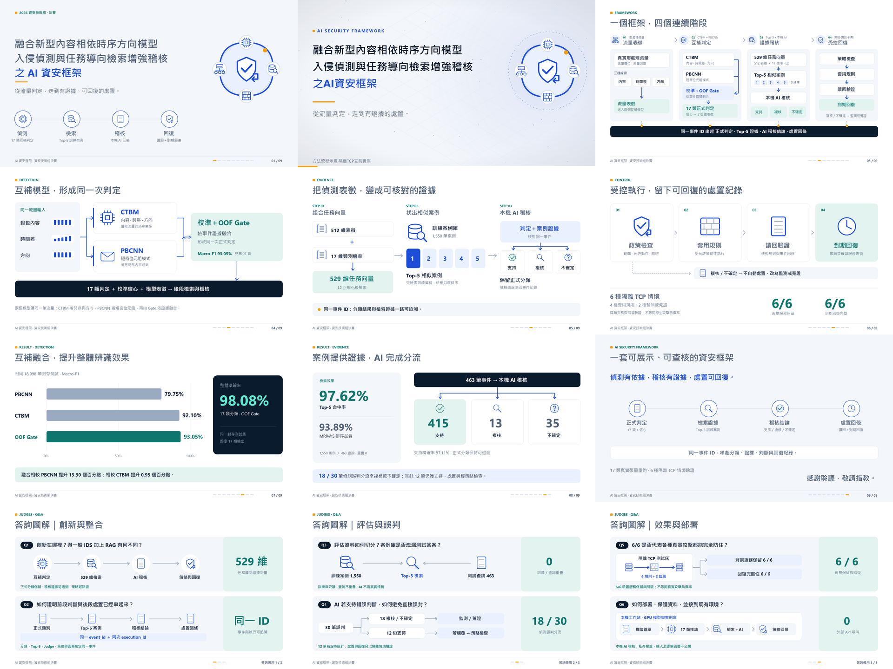
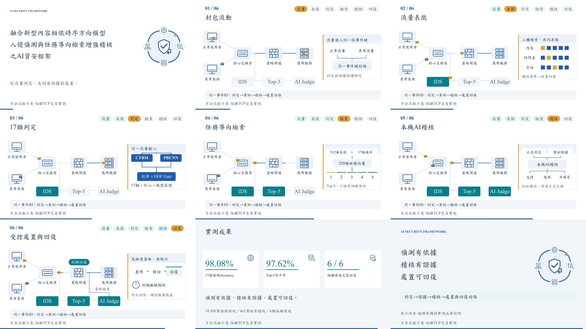
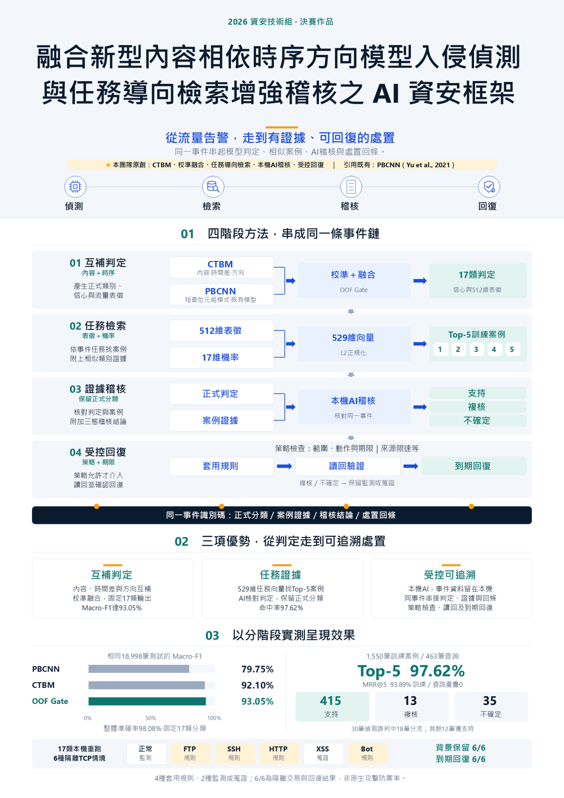
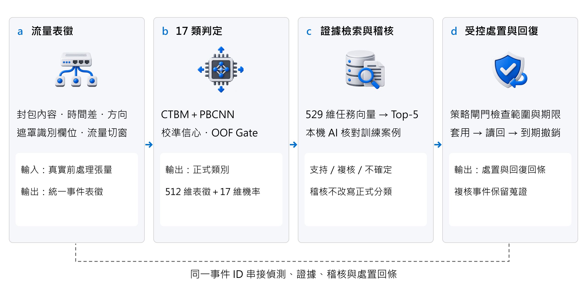

# AI 資安框架｜資服競賽

融合新型內容相依時序方向模型入侵偵測與任務導向檢索增強稽核之 AI 資安框架

本作品以同一事件串接17類入侵偵測、訓練案例檢索、本機AI稽核與受控處置。前段提供正式分類、校準信心與流量表徵；後段附上Top-5證據、稽核結論、策略檢查及回復回條，保留各階段的來源與執行關係。

**[下載決賽簡報](deliverables/決賽簡報_AI資安框架.pptx)** · **[觀看／下載30秒方法動畫](deliverables/AI資安框架_系統展示影片_30秒快版.mp4)**

**[A2海報印刷PDF](deliverables/決賽海報_AI資安框架_A2.pdf)** · **[海報可編輯PPTX](deliverables/決賽海報_AI資安框架_A2.pptx)**

**[下載離線互動展示HTML](deliverables/interactive/AI資安框架_離線互動展示.html)** · [互動展示操作與範圍](deliverables/interactive/README.md)

互動展示可直接下載後用瀏覽器開啟，提供四種情境、暫停、調速、時間軸與資料觀察窗。它使用合成示意資料解說方法，不執行真實模型或網路規則；正式實測仍以本文結果與本機模型控制台為準。

[下載離線簡報、影片與海報備援包](deliverables/決賽離線展示包.zip) · [簡報PDF備援](deliverables/決賽簡報_AI資安框架.pdf) · [正式版本封存與SHA256](https://github.com/Lily09-project/innoserve-competition/releases)

[成果與規格](#成果與規格) · [系統方法](#系統方法與創新) · [實測結果](#實測結果與適用範圍) · [公開測試](#公開程式測試) · [完整執行](#完整本機模型與隔離驗證) · [目錄](#專案目錄與來源) · [發布範圍](#公開內容與版本維護)



[](deliverables/AI資安框架_系統展示影片_30秒快版.mp4)

<details>
<summary>查看加豐版 A2 海報預覽</summary>

[](deliverables/決賽海報_AI資安框架_A2.pdf)

</details>

## 成果與規格

| 交付項目 | 內容與用途 | 原始來源 |
| --- | --- | --- |
| 決賽簡報 | 12頁：9頁正式報告、結束頁後3頁六題圖解備詢；第2頁內嵌30秒影片，各頁附繁體中文講者備忘稿 | [逐頁SVG](deliverables/source/slides/)、[製作程式](scripts/presentation/editorial_assets.py)、[講者稿](deliverables/source/speaker-notes.md) |
| 方法動畫 | 1920×1080、24fps、30秒、2倍速、無音軌；以網路拓樸與封包傳遞說明完整流程 | [動畫來源](media/film/scene.mjs)、[渲染程式](scripts/render_product_film.mjs) |
| A2海報 | 420×594mm直向；34pt置中作品名稱、四階段產物、Top-5圖卡、策略例子、實測比較與六情境圖解 | [原生製作程式](scripts/presentation/build_a2_poster.py)、[印刷規格](deliverables/source/poster-a2-spec.md) |
| 離線包 | 簡報、影片、海報、口語稿、答詢、備援卡、互動HTML及SHA256清單 | [包裝程式](scripts/package_finals.py) |
| 驗收索引 | 正式檔案、來源、預覽與實測彙整的雜湊及驗收範圍 | [交付清單](deliverables/source/delivery-manifest.json)、[實測索引](deliverables/source/release-validation.json) |

三種成果共用白底／極淺灰底、深藍與藍色流程、青綠主要方法及少量暖金提示，中文及中文標點使用標楷體DFKai-SB，其他文字使用Times New Roman。簡報關閉換頁特效與裝飾動畫，保留第2頁的內嵌媒體時序。報告規劃為五分鐘含影片，另留一分鐘緩衝；現場上限六分鐘，答詢七分鐘。

海報加豐版補入適用對象、各階段產物、FTP／SSH、HTTP型DDoS與Bot策略例子，以及六種隔離情境的規則／監測／蒐證路徑。所有正式交付物保持匿名；公開儲存庫的帳號資訊不放進競賽投影或海報。

設計參考與原創轉譯見[海報與影片參考紀錄](docs/海報與影片參考轉譯.md)。正式成果可直接下載使用；完整模型展示另依下方工作站設定執行。

### 決賽直接使用

1. 正式報告依[五分鐘口語稿](docs/決賽五分鐘口語稿.md)，第2頁播放30秒影片，第9頁結語；預留一分鐘緩衝。
2. 第10至12頁搭配[六題答詢口徑](docs/決賽六題答詢口徑.md)，先回答、再指圖與證據。
3. 操作者使用[現場控場與備援卡](docs/現場控場與備援卡.md)，以情境名稱選事件，區分即時模型與保存結果。
4. 下載上方離線包，依內附SHA256核對檔案；它是簡報備援包，完整模型仍使用已配置的工作站。

[流程設定](deliverables/source/finals-runbook.json)固定12頁、五分鐘配置、影片位置及六題對應；[決賽驗收索引](deliverables/source/finals-readiness.json)綁定正式檔案與操作材料。執行`python scripts/check_finals_readiness.py`可核對數據口徑、內外嵌影片、頁序、時間配置及離線包，檔案變動而未同步時會停止。時間配置不是講者實際朗讀紀錄；朗讀、場地可讀性與海報打樣另由現場確認。

## 系統方法與創新



| 階段 | 主要處理 | 交付到下一階段的產物 |
| --- | --- | --- |
| 互補偵測 | CTBM讀取封包內容、時間差與方向；PBCNN補充短窗位元組模式，經校準與OOF Gate融合 | 固定17類正式判定、校準信心、512維流量表徵 |
| 任務導向檢索 | 將512維表徵與17維類別機率組成529維向量，經L2正規化後查詢訓練案例庫 | 同事件Top-5案例與排序證據 |
| 本機AI稽核 | 核對正式判定、信心、分支判定及案例證據，回傳支持、複核或不確定 | 附加稽核結論，保留原正式分類 |
| 受控處置與回復 | 策略閘門檢查類別、支持證據、信心、動作白名單、範圍與期限 | 允許動作、規則讀回、實際隔離量測及回復回條 |

創新重點在於互補模型產生一次正式判定、以任務向量取得相關證據，以及讓判定、稽核、策略和回條可沿同一事件追溯。AI支持結論仍須通過策略檢查；複核與不確定事件保留監測或蒐證路徑。

完整17類名稱與策略對照以[事件合約](app/pipeline.py)為準；[框架說明](FRAMEWORK.md)與[程式審查修正](docs/程式審查修正.md)說明資料交接及拒絕錯誤的條件。

## 實測結果與適用範圍

| 實驗範圍 | 已記錄結果 | 公開來源 |
| --- | --- | --- |
| 相同18,998筆封存偵測測試 | Accuracy 98.08%；Macro-F1 93.05%；PBCNN與CTBM的Macro-F1分別79.75%、92.10% | [偵測彙整](results/detection_17class.json) |
| 1,550筆訓練案例、463筆查詢 | Top-5 97.62%；MRR@5 93.89%；訓練／查詢ID重疊0 | [檢索彙整](results/retrieval_17class.json) |
| 同一批463筆本機AI稽核 | 415支持、13複核、35不確定；支持精確率97.11% | [稽核彙整](results/local_judge_17class.json) |
| 17類真實前處理張量重跑 | 17次本機推論與17次本機AI呼叫，正式類別及Top-5案例排序與保存結果對齊 | [整合彙整](results/framework_validation.json)、[證據索引](deliverables/source/release-validation.json) |
| 預定6種隔離TCP情境 | 4種套用規則、2種監測或蒐證；背景保留6/6、回復完整性6/6 | [六情境逐項彙整](results/framework_validation.json) |

30筆封存偵測誤判中18筆分流至複核或不確定，12筆仍獲AI支持。稽核不改寫正式分類，因此不能將分流數據解讀為新的分類準確率。6/6量測的是隔離TCP測試交易、背景服務與期限回復，並非原生攻擊防禦率或漏洞修補率。

展示目前使用真實流量的預先處理張量，重跑模型及後段流程。程式動畫中的拓樸、特徵方塊與案例順位用於說明方法；實測數值統一由上述JSON取得。詳細樣本延遲、各類別表現與限制見[實測與證據索引](docs/實測與證據索引.md)。

### 策略風險與弱項分析

[策略風險分析](results/policy_risk_analysis.json)將463筆保存事件重新通過檢索與策略閘門。12筆偵測錯誤但AI支持的事件中，6筆被策略擋下，6筆仍允許介入。這是策略授權統計，沒有部署網路規則，不能解讀為已發生6次誤封；AI支持與信心門檻也不保證判斷正確。

同一彙整提供Web-XSS與Web-BruteForce的封存測試混淆及463筆查詢分析。本輪保持既有模型與測試切分，分析不作為以測試答案調參的依據。復原實測與操作範圍見[決賽穩定性與操作整合](docs/決賽穩定性與操作整合.md)。

## 公開程式測試

公開版不需要私有模型即可執行合約測試與媒體編譯檢查。使用Python 3.11、Node.js 24、pnpm 11.25.0與專案鎖檔；CI配置見[工作流程](.github/workflows/tests.yml)。

```bash
git clone --recurse-submodules https://github.com/Lily09-project/innoserve-competition.git
cd innoserve-competition
python -m pip install -r requirements-test.txt
python -m unittest discover -s tests -v
pnpm install --frozen-lockfile
pnpm run test:media
pnpm run check:media
node tests/media-render-smoke.cjs
node tests/media-data.cjs
node tests/offline-exhibit.cjs
python scripts/media_results.py --check
python scripts/check_delivery_docs.py
python scripts/check_public_files.py
```

已有clone時先執行`git submodule update --init --recursive`。子模組必須初始化，才能載入真正的共用策略元件。

目前141項Python測試涵蓋事件合約、Judge上下文、策略、逐筆證據、資產匯入、預檢、API、字型、匿名與交付一致性。媒體檢查另編譯九個動畫章節。測試中的合成fixture只測程式邊界，不列入模型成效；CI通過也不代表重新執行真實模型。完整項目見[測試矩陣](docs/測試矩陣.md)。

## 完整本機模型與隔離驗證

### 1. 準備工作站與設定

完整展示需偵測checkpoint、本機Llama模型、案例庫、逐筆稽核紀錄與17類展示張量。已驗證工作站使用RTX 4090、PyTorch 2.7.1及CUDA 12.6；隔離網路使用Windows WSL、Mininet與iptables。

Windows PowerShell建立並啟用虛擬環境：

```powershell
python -m venv .venv
.\.venv\Scripts\Activate.ps1
python -m pip install -r requirements.txt
Copy-Item config.example.json config.local.json
```

PyTorch的CUDA安裝須符合本機設備。`requirements-test.txt`供公開測試、`requirements.txt`供模型推論、`requirements-media.txt`供媒體製作，三者用途不同。

依[設定範例](config.example.json)填寫：

| 設定 | 內容 |
| --- | --- |
| `ids_reference_root` | 凍結IDS結果目錄，包含runtime_sources、三個checkpoint、Gate設定與validation預測 |
| `gate_impl_path` | 對應的Gate實作檔；未設定時使用IDS結果目錄上一層的預設檔 |
| `ids_data_root` | 僅重建案例庫時需要的原始train／validation／test資料目錄；已匯入展示資產的推論與預載不需要此設定 |
| `llama_model_dir` | 合法取得的本機Llama 3 8B Instruct模型快照及tokenizer |
| `python_executable` | 安裝模型依賴的Python執行檔 |
| WSL及逾時設定 | 使用實際的distribution、user及工作期限；預設值見範例 |

相對路徑以專案根目錄解析。`INNOSERVE_欄名大寫`環境變數優先於本機設定，實作見[settings.py](app/settings.py)。

### 2. 匯入既有資產，或在新工作目錄重建

已有完整私有交付資料時，匯入後的推論與模型預載只使用權重、Gate、案例庫及展示張量，不要求原始train／test資料目錄：

```bash
python scripts/import_local_assets.py --source PATH_TO_LOCAL_DELIVERY
```

匯入器先檢查完整JSON／NPZ內容、案例庫hash、標籤、事件配對、Judge上下文與17類張量，再發布至`evidence/fresh17/`。已有目標（包含空目錄）即拒絕，不覆寫或合併既有資料。

沒有既有展示資料時，在獨立的新工作目錄配置原始資料與權重後執行：

```bash
python scripts/rebuild_retrieval.py
python scripts/run_local_judge.py
```

第一支程式重建訓練案例庫、查詢事件及17類展示張量；第二支程式產生同事件本機AI回覆。資料選取與前處理版本會影響結果，重建後需重新驗證，不能直接沿用公開彙整數字。`prepare_closed_loop.py`另供保存式串接整理，不等同即時模型或期限回復驗證。

### 3. 啟動、預載與展示

在第一個終端啟動API：

```bash
python app/server.py --port 8765
```

在另一個已啟用模型環境的終端執行：

```bash
python scripts/preflight.py --warmup
python scripts/demo_walkthrough.py --mode live --event-index 0
```

Windows可直接使用[決賽展示.cmd](決賽展示.cmd)進入匿名控制台，選正常、FTP、SSH、HTTP、Bot或複核情境，不需記憶事件索引。控制台可預檢與預載，明確選擇即時模型或保存結果備援。舊[啟動作品.cmd](啟動作品.cmd)仍供只啟動API使用。本機狀態入口為`http://127.0.0.1:8765/api/status`，服務提供模型與事件API，不提供已捨棄的網站介面。`preflight`會核對權重、CUDA、隔離依賴及執行來源；檢查失敗不報READY。

需要隔離處置展示時，在支援測試流量設定的即時事件上加`--network`；此選項會真正建立隔離情境並等待期限回復。`--mode saved`則重新查詢保存事件的證據，使用已綁定回覆，不宣稱本次重新執行偵測模型或LLM。完整操作見[本機匿名展示操作單](docs/本機展示操作單.md)。

一鍵展示亦可指定情境：

```bash
python scripts/showcase.py --prepare-only
python scripts/showcase.py --scenario ssh --mode live --network
python scripts/showcase.py --scenario review --mode saved
```

隔離工作在Linux端設定期限，併發工作由專案鎖拒絕；回條必須包含規則、服務與網路介面的清理證明。離開控制台不等於中斷服務，執行中的隔離工作會依服務端期限及清理流程結束。

更新程式後若預檢指出舊服務，先在非投影終端停止閒置API，再重新啟動控制台：

```powershell
Invoke-RestMethod -Uri http://127.0.0.1:8765/api/stop -Method Post -ContentType application/json -Body '{}'
```

執行中工作會回覆busy，需等隔離回復與清理完成後再停止；不以強制終止取代回復。

### 4. 完整驗收與公開彙整

```bash
python scripts/audit_final_chain.py
python scripts/finals_pipeline.py --refresh-evidence --audit-dir PATH_TO_SUCCESSFUL_AUDIT
```

第一步重跑17類推論、17次本機AI及預定六種隔離情境。後續檢查checkpoint、案例排序、逐筆紀錄、規則讀回、實際影響與期限回復，再匯出彙整與發布索引。舊來源、不同資產或失敗回條不會被當作新版成功證據。模型執行來源改動後，必須重新取得成功驗收紀錄，不能只修改舊證據的版本欄位。

完整規則、前置條件與驗收範圍見[驗收與重現方式](docs/驗收與重現方式.md)。依使用者要求，原生播放測試不列本次驗收；影片採離線解碼、影格、時長、內外嵌位元組及字型／座標檢查。

### 5. 更新媒體數據與重製成果

影片、簡報與海報共用經驗證的[媒體數據快照](media/film/metrics.json)。更新四份results後，先執行：

```bash
python scripts/media_results.py
python scripts/media_results.py --check
```

此步驟只驗證既有彙整並重建媒體數據，不執行或替代模型實驗。若指標改變，須重製媒體、預覽及離線包後，再執行release_inventory與交付檢查。快照包含四份來源的雜湊與共同指標；來源變更而快照未更新時，產生器會停止，避免輸出舊數據。CI會檢查快照、文件連結及交付manifest，包含12張公開SVG。

媒體重製使用`scripts/render_product_film.mjs`，設定`FFMPEG_BINARY`並使用新的輸出目錄；製作工作站須安裝標楷體與Times New Roman。舊的`render_film_resvg.py`已停用，執行會回報錯誤且不產生影片，避免替換成不符規格的字型。完整製作及交付同步步驟見[來源說明](deliverables/source/README.md)。

### 6. 交付驗證與封裝

```bash
python scripts/finals_pipeline.py
python scripts/finals_pipeline.py --stage validation/NEW_DELIVERY_FOLDER
```

封裝SVG使用純向量產生器；Pillow僅供歷史點陣圖裁切工具使用，不是此封裝路徑的必要依賴。入口依序檢查媒體快照、完整測試、九章節編譯、資料更新、文件與公開檔案。封裝會重新產生12頁SVG並核對來源，複製通過驗證的正式成果及SHA256清單至新目錄，不覆寫既有目錄。原生PPT、影片與海報保留核對後的位元組；如果SVG內容改變，會停止封裝，要求先完成正式原生匯出與版面驗證，不把新SVG當成已更新的PPT。

證據刷新步驟失敗時，會還原原有公開彙整、快照及交付索引；診斷和備份留在本機validation。

## 專案目錄與來源

| 路徑 | 用途 |
| --- | --- |
| [app/](app/) | 17類事件合約、本機推論、Judge解析、策略閘門、API、設定與資產驗證 |
| [scripts/](scripts/) | 案例重建、稽核、匯出、預檢、公開檔案及交付檢查 |
| [scripts/presentation/](scripts/presentation/) | 簡報／海報製作、字型正規化、影片封裝與對齊量測 |
| [media/film/](media/film/) | 純程式產品動畫來源 |
| [design-system/](design-system/) | 共用色盤、兩種字型、平面圖示與視覺規格 |
| [deliverables/](deliverables/) | 正式PPTX、PDF、MP4、離線ZIP及預覽 |
| [deliverables/source/](deliverables/source/) | 最新12頁SVG、架構圖、設計規格、講者稿及交付索引 |
| [results/](results/) | 四份核心實測彙整及策略風險分析 |
| [tests/](tests/) | 程式合約、交付一致性與媒體檢查 |
| [docs/](docs/) | 方法、答詢、重現、驗收及版本紀錄 |
| [sources/paper_code/](sources/paper_code/) | 第三方研究程式子模組，固定版本與來源由Git記錄 |
| [.github/](.github/) | CI、PR範本與核心程式審查規則 |

逐頁SVG是可編輯的設計來源；第2頁SVG描述影片位置，MP4由封裝步驟內嵌到PPTX。正式PPTX另有原生字型與實際字形對齊校正，應以正式檔作投影及編輯交付。製作步驟見[來源說明](deliverables/source/README.md)、[簡報規格](deliverables/source/presentation-design-spec.md)及[海報規格](deliverables/source/poster-a2-spec.md)。

## 公開內容與版本維護

| 納入GitHub | 保留本機 |
| --- | --- |
| 原創程式、共用視覺來源、12張SVG、說明與測試 | checkpoint、LLM權重、tokenizer快照及原始流量 |
| 核心彙整及風險分析、正式簡報／影片／海報／離線包 | 案例向量庫、逐筆事件、Judge原始回覆及私有回條 |
| 設定範例、依賴清單、子模組版本、雜湊索引 | config.local.json、環境憑證、執行日誌、暫存／舊版製作目錄 |

公開範圍以[.gitignore](.gitignore)、[公開檔案檢查](scripts/check_public_files.py)及[發布盤點](docs/公開發布盤點.md)為依據。正式資產、預覽與來源變更後需同步交付索引；十二張逐頁SVG也納入LF正規化雜湊檢查，避免只更新PPT而留下舊來源。

模型、程式與彙整結果由不同層級的驗證紀錄綁定；最新成果以`main`、[交付manifest](deliverables/source/delivery-manifest.json)及[release-validation](deliverables/source/release-validation.json)為準。不要把私有部署資產誤認為漏推送的公開內容。

## 文件與授權

- [決賽內容與數據基準](docs/決賽內容基準.md)
- [方法與現場答詢](docs/決賽展示與答詢.md)
- [展前驗收與備援](docs/展前驗收與備援.md)
- [完整交付驗收](docs/完整交付驗收.md)
- [實測與證據索引](docs/實測與證據索引.md)
- [架構圖設計與驗收](docs/架構圖設計與驗收.md)
- [決賽穩定性與操作整合](docs/決賽穩定性與操作整合.md)
- [完整程式審查追補修正](docs/完整程式審查追補修正.md)
- [版本與檢查紀錄](docs/版本與檢查紀錄.md)
- [協作規則](CONTRIBUTING.md)

原創程式採[Apache-2.0](LICENSE)。第三方子模組、模型及資料維持各自授權，見[NOTICE.md](NOTICE.md)。修改透過PR與CI合併，核心合約依專案審查規則處理。

### English summary

This project integrates 17-class intrusion detection, task-oriented retrieval of training-only evidence, local AI auditing, and policy-controlled actions with readback and expiry rollback. The public repository includes source code, recorded aggregate results, editable slide sources, a 12-slide finals presentation, a 30-second method animation, and an A2 poster. Model weights, raw traffic, per-event traces and workstation configuration remain private. The six network scenarios validate isolated TCP transactions and rollback rather than native exploit prevention.
